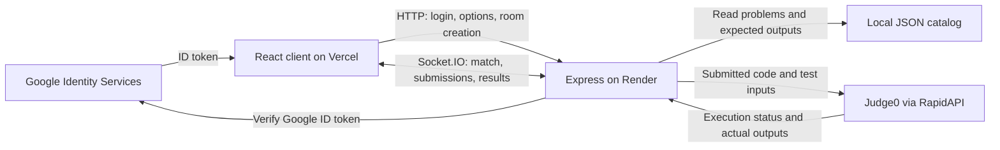

# CodeClash

**LeetCode Battles. Real-Time Duels.**

**[Live Demo](https://code-clash-mu-blond.vercel.app/)**

CodeClash turns interview preparation into a real-time coding competition. Two players join a private room, receive the same problem, and race to submit a correct solution. The server judges submissions through Judge0 and declares the first fully correct submission the winner.

The current MVP focuses on one working two-player match. Problems and expected answers come from local JSON files; no LeetCode API or database is required.

## Current features

- **Private 1v1 rooms:** create a server-generated match code and share it with another player. A match starts when both players join.
- **Problem preferences:** the creator chooses difficulty and topic, or **Any** for either. Unavailable combinations are disabled; joining does not change the creator's preferences.
- **JavaScript and Python:** problem-specific starter code and separate drafts when switching languages.
- **Visible examples:** both players see the first two stored test cases with their expected outputs. The full test suite stays on the server.
- **Real code execution:** Judge0 runs submissions; the backend validates returned outputs against the original catalog rather than trusting printed pass counts.
- **Server-controlled timing:** both players use the same deadline. Late results cannot overwrite an ended match.
- **Reliable results:** winners are identified by player ID, with victory, defeat, timeout, and cancellation displays.
- **Refresh and reconnect recovery:** restore the assigned problem, deadline, submission state, and per-language drafts while the original server remains running.
- **Departure handling:** the opponent sees connection changes. A disconnected player has 30 seconds to reconnect; an explicit leave cancels immediately.
- **Google sign-in and profile setup:** Google credentials are verified by the backend. Profile and match state do not require a database.
- **Match UI:** difficulty colors, lightweight victory confetti, and reduced-motion support.

**Run Tests & Submit** is a real match submission and can end the match if all tests pass. There is no separate practice-only test action.

## Supported problems and languages

Only problems with implemented runners are eligible for matches, even if the JSON catalog contains additional entries.

| Problem ID | Problem                                               | Topic       | Difficulty | Stored tests |
| ---------- | ----------------------------------------------------- | ----------- | ---------- | ------------ |
| 2          | Two Sum                                               | Arrays      | Easy       | 10           |
| 3          | Add Two Numbers                                       | Linked list | Medium     | 10           |
| 4          | Binary Tree Inorder Traversal                         | Binary tree | Medium     | 10           |
| 5          | Number of Connected Components in an Undirected Graph | Graph       | Medium     | 10           |

Every supported problem can be played in **JavaScript** (Judge0 language ID `63`) or **Python 3** (`71`). Python submissions use the standalone functions supplied in the starter code; the runners provide the required linked-list and tree node types.

Match duration depends on the selected problem:

| Difficulty | Duration   | Currently available           |
| ---------- | ---------- | ----------------------------- |
| Easy       | 15 minutes | Yes                           |
| Medium     | 20 minutes | Yes                           |
| Hard       | 30 minutes | No supported Hard problem yet |

Two Sum accepts valid indices in either order, including another valid pair when the input permits one. Validation uses the original inputs and requires distinct, in-range integer indices.

## Tech stack

| Layer                   | Technologies                                                                            |
| ----------------------- | --------------------------------------------------------------------------------------- |
| Frontend                | React 18, Create React App / `react-scripts` 5, Tailwind CSS, Lucide React              |
| Real-time communication | Socket.IO 4 client and server                                                           |
| Backend                 | Node.js 22.x, Express 4, Axios, `google-auth-library`, dotenv for local development     |
| Code execution          | Judge0 CE through RapidAPI; JavaScript and Python runners                               |
| Data                    | `server/data/problems.json`, in-memory rooms, browser storage for profiles and recovery |
| Tooling                 | npm workspaces, shared lockfile, nodemon, concurrently                                  |
| Validation              | Node test runner, frontend Jest tests, Python 3 for local runner checks                 |
| Deployment              | Vercel for the frontend; one Render Web Service for the backend                         |

Legacy database, password, and JWT dependencies remain in the repository, but the current match flow does not use a database or JWT-based server sessions. The code editor is a React input, not Monaco.

## Architecture



1. The frontend sends a Google ID token to `POST /api/auth/google`; the backend verifies it against the configured web client ID.
2. The creator loads available combinations from `GET /api/game/options` and creates a room through `POST /api/game/rooms`.
3. Both players join using Socket.IO. The server selects an eligible problem, reserves stable player identities, and broadcasts the problem and deadline.
4. A submission is wrapped for its language and sent to Judge0 with test inputs. Hidden expected outputs are not included in the execution request.
5. The server parses untrusted execution output, validates it against the preserved catalog, and broadcasts a final result when a submission passes all tests or the match otherwise ends.

Recovery uses a private, per-tab resume token and `sessionStorage`. A timely reconnect restores the existing match rather than choosing a new problem or restarting its timer. Waiting rooms and completed outcomes are retained for 15 minutes. Active matches keep their original deadline during interruptions.

All room state lives in one backend process. Recovery does **not** survive a backend restart or redeployment.

## Repository structure

```text
Code-Clash/
|-- client/
|   |-- src/pages/             Match, arena, login, and other UI
|   |-- src/services/api/      HTTP API clients
|   |-- src/sockets/           Socket.IO client configuration
|   |-- scripts/validateEnv.js Production frontend configuration checks
|   `-- .env.example          Public frontend variable template
|-- server/
|   |-- app.js                Express routes, health endpoint, startup
|   |-- sockets/matchSocket.js Room lifecycle and authoritative match state
|   |-- data/problems.json    Local problem catalog and expected outputs
|   |-- utils/wrappers.js     JavaScript/Python execution adapters
|   |-- utils/judgeResult.js  Server-side output validation
|   |-- utils/judge0Helper.js External execution requests
|   |-- tests/                Local and live Judge0 checks
|   `-- .env.example          Backend variable template
|-- package.json              Workspace scripts and Node version
|-- package-lock.json         Shared dependency lockfile
|-- vercel.json               Frontend deployment configuration
|-- DEPLOYMENT.md             Detailed hosting and verification instructions
`-- constraints.md            MVP implementation contract
```

## Run locally

### Prerequisites

- Node.js **22.x** and npm.
- A Google OAuth **Web application** client ID.
- A working Judge0 RapidAPI subscription and API key.
- Python 3 available as `python` to run the local backend test suite. Python is not required on Render: production Python submissions run in Judge0.

Clone this repository using its GitHub **Code** URL and check out the branch containing the current MVP changes. If you deploy a fork, use that same repository and branch for both hosts.

From the repository root, install all workspace dependencies with the shared lockfile:

```powershell
npm ci --include=dev
```

### Environment configuration

Create local files from the templates. These PowerShell commands preserve any existing files:

```powershell
if (!(Test-Path client/.env)) { Copy-Item client/.env.example client/.env }
if (!(Test-Path server/.env)) { Copy-Item server/.env.example server/.env }
```

Replace placeholders with your own values:

| File          | Variable                     | Local value or purpose                    |
| ------------- | ---------------------------- | ----------------------------------------- |
| `client/.env` | `REACT_APP_API_URL`          | `http://localhost:3001`                   |
| `client/.env` | `REACT_APP_SOCKET_URL`       | `http://localhost:3001`                   |
| `client/.env` | `REACT_APP_GOOGLE_CLIENT_ID` | Your real Google web client ID            |
| `server/.env` | `NODE_ENV`                   | `development`                             |
| `server/.env` | `PORT`                       | `3001`                                    |
| `server/.env` | `CLIENT_ORIGIN`              | `http://localhost:3000`                   |
| `server/.env` | `GOOGLE_CLIENT_ID`           | The same Google client ID as the frontend |
| `server/.env` | `JUDGE0_API_URL`             | Your subscribed `/submissions` endpoint   |
| `server/.env` | `JUDGE0_API_HOST`            | Your RapidAPI endpoint hostname           |
| `server/.env` | `JUDGE0_API_KEY`             | Your private RapidAPI key                 |

For Judge0 CE on RapidAPI, the template uses `https://judge0-ce.p.rapidapi.com/submissions` and host `judge0-ce.p.rapidapi.com`. Confirm these match your subscription.

In Google Cloud, add `http://localhost:3000` to the web client's **Authorized JavaScript origins**. Ensure its consent/audience settings allow your test accounts.

Private `.env` files are ignored by Git; `.env.example` files are templates. Never place the Judge0 key in frontend variables: `REACT_APP_*` values are visible in the browser bundle. Save environment changes and restart the affected development server.

### Start the application

From the repository root:

```powershell
npm run dev
```

- Frontend: `http://localhost:3000`
- Backend: `http://localhost:3001`
- Backend health: `http://localhost:3001/health`

Alternatively, start each workspace in a separate terminal:

```powershell
npm run dev --workspace=server
```

```powershell
npm start --workspace=client
```

The root `npm start` also starts development processes. It is not the production backend command.

### Play a match

1. Open the frontend in two browser sessions, such as a normal window and an Incognito window, and sign in.
2. One player creates a room with the desired available topic and difficulty, then shares the match code.
3. The second player joins that code. Both receive the same problem, examples, and deadline.
4. Choose JavaScript or Python, edit the provided function, and use **Run Tests & Submit**.
5. The first submission verified as fully correct wins; the opponent receives the defeat screen. Failed submissions can be corrected while the match remains active.

Refresh within the 30-second reconnection grace period to recover the match and saved drafts. Leaving intentionally, or failing to reconnect in time, cancels the match with a clear result for the opponent and no winner. The deadline continues during a disconnect.

## Tests and verification

From the repository root:

```powershell
npm test --workspace=server
npm test --workspace=client -- --watchAll=false --runInBand
```

Backend checks cover the supported language runners, output verification, Judge0 helper behavior, match recovery and cancellation, malformed payloads, and deployment configuration. They use local or mocked execution and do not require real Google or Judge0 credentials. The runner checks require Python 3.

To verify your actual Judge0 service:

```powershell
npm run test:judge0 --workspace=server
```

This command loads your local `server/.env`, sends code and test inputs to Judge0, and consumes service quota: **16 submissions on a successful run**. It checks correct solutions for all four problems in both languages and rejects incorrect or invalid executions, including JavaScript collector-access and input-mutation attempts. See [the judging test guide](server/tests/README.md).

`GET /health` reports server liveness and configuration. A configured status does **not** prove Google sign-in succeeds, the RapidAPI key works, or Judge0 can execute code. Verify those through real login and live execution, then test a complete two-player match.

## Deploy to Vercel and Render

Deploy the frontend to **Vercel** and the long-running Express/Socket.IO backend to **Render**. Keep the repository root as both services' root directory so npm can resolve the workspaces and shared lockfile. Configure both hosts to use the same committed branch containing the MVP fixes.

| Setting                      | Vercel frontend                    | Render backend                        |
| ---------------------------- | ---------------------------------- | ------------------------------------- |
| Service / framework          | Single frontend project, **Other** | Node **Web Service**                  |
| Root directory               | `./` (repository root)             | Leave blank (repository root)         |
| Install / build dependencies | `npm ci --include=dev`             | `npm ci --include=dev`                |
| Build command                | `npm run build --workspace=client` | Dependency installation command above |
| Output directory             | `client/build`                     | Not applicable                        |
| Start command                | Static frontend hosting            | `npm start --workspace=server`        |
| Node version                 | `22.x`                             | `22.x`                                |
| Health check                 | Not applicable                     | `/health`                             |

The root [vercel.json](vercel.json) supplies the frontend build settings. Import the frontend as a single project; the backend remains on Render.

**Vercel production variables:**

- `REACT_APP_API_URL`: your HTTPS Render origin.
- `REACT_APP_SOCKET_URL`: the same HTTPS Render origin.
- `REACT_APP_GOOGLE_CLIENT_ID`: your real Google web client ID.

**Render variables:**

- `NODE_ENV=production`
- `CLIENT_ORIGIN`: your stable HTTPS Vercel origin.
- `GOOGLE_CLIENT_ID`: the same Google web client ID used by Vercel.
- `JUDGE0_API_URL`, `JUDGE0_API_HOST`, and `JUDGE0_API_KEY`: your subscribed Judge0 settings; the key stays on the backend.

Use origins without paths: do not append `/api` or `/socket.io` to frontend API/socket variables. Express and Socket.IO enforce the configured frontend origin. Arbitrary Vercel preview origins are not automatically allowed.

Render supplies `PORT`; the backend binds to `0.0.0.0` on that port. Do not override it with the local `3001`. Production startup validates required settings and uses hosting environment variables rather than loading `server/.env`.

The frontend production build validates its public variables before bundling. This also applies to a local `npm run build --workspace=client`: provide the production HTTPS origins and Google ID. Changes to frontend environment variables require a new build.

Add the final Vercel origin to Google's **Authorized JavaScript origins**, keep both client IDs identical, and verify the accounts used for the demo are permitted. The app uses a popup credential callback rather than a backend OAuth redirect flow.

Use **one backend instance**, preferably always-on for the interview. In-memory matches cannot be shared across instances or restored after a restart. An idle free backend may need a cold start. Avoid redeploying during the demo.

See [DEPLOYMENT.md](DEPLOYMENT.md) for deployment order, exact dashboard settings, provider setup, and the production acceptance checklist. Legacy Netlify configuration is not part of this Vercel/Render setup.

## MVP boundaries and remaining limits

The original idea includes broader competitive interview practice. The current working scope is private two-player matches; tournaments, rankings, leaderboards, matchmaking queues, persistent history, monetary rewards, and email/password login are not supported MVP features. Some related UI or legacy code remains and should not be presented as a completed service.

- **No persistent match storage:** rooms, timers, and outcomes disappear on backend restart. Browser recovery cannot restore lost server state.
- **Public-service hardening remains:** Google credentials are verified at login, but room creation and socket membership are not protected by an enforced backend login session. Submission rate limiting is also absent. CORS does not provide authentication or prevent quota abuse.
- **External services need real checks:** hosting health checks cannot verify Google account permissions or Judge0 subscription/quota. Test both services and two browser sessions at the deployed URL before presenting.
- **Minor static asset debt:** the HTML references missing favicon/manifest/logo files. Those requests can return 404; they do not prevent the match flow.

Read [constraints.md](constraints.md) before extending the application. Keep the JSON catalog, server-authoritative match flow, supported language adapters, and recovery contract consistent when making future changes.
